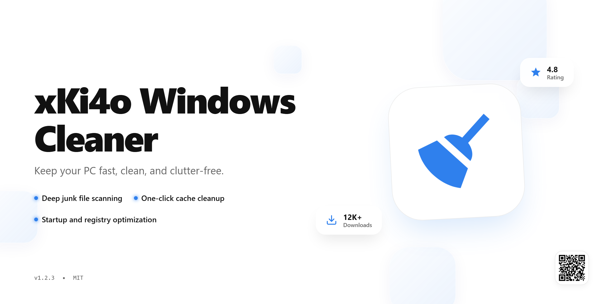

# xKi4o Windows Cleaner — Advanced System Optimization & Maintenance Toolkit for Windows

### 🖥️ PowerShell Setup

    

---

xKi4o Windows Cleaner is a portable desktop utility that consolidates system maintenance, optimization, and configuration into a single native executable for Windows and. It provides real-time telemetry on processor, graphics, memory,, and network subsystems alongside targeted of caches and temporary data across the OS, browsers, and applications. The integrated tweaker exposes approximately ninety system adjustments grouped into preset profiles, while supplementary modules handle residual-aware uninstallation, scheduled update orchestration, and hardware diagnostics. Every system modification is preceded by a restore point and can be reverted from within the interface, and the application operates without background telemetry or external dependencies beyond its own update check.

## 🔧 Requirements

- **OS:** Windows 10 / 11
- **Shell:** PowerShell 5.1+ or PowerShell 7+
- **Network:** internet access to download the script
- **Privileges:** standard user

## Features

**Unified health dashboard:** A single live view of processor load, graphics adapter status (including temperature and video memory on supported hardware), memory pressure, system drive utilization, and network throughput. The dashboard aggregates these signals into a composite score, identifies the components dragging it down, and surfaces a one-click recommended action set.

- **Targeted engine:** Scans and reports cache and temporary storage across Windows components, browsers, game clients, and installed applications. Each category displays its reclaimable size before any deletion occurs, so decisions are made with full visibility rather than guesswork.

- **Application management suite:** Uninstalls programs while scanning for residual files and registry remnants, removes packaged Store applications, installed software through the winget package manager, and supports batch installation of a user-selected program set from a curated catalog.

- ** tweaker:** Roughly ninety system-level adjustments organized into one-click presets (Essential,, Privacy, Ultimate). Every modification captures its prior state, so disabling a tweak restores the original configuration precisely rather than approximating it.

- **Portable single-executable architecture:** The complete toolset ships as one portable executable with no installer dependency, no background services, and no telemetry pipeline. Configuration and state remain local to the application directory.

## How It Works

xKi4o Windows Cleaner operates on a modular, layered architecture that separates scanning, analysis, and execution into distinct phases. This ensures that every operation remains transparent,, and non-destructive by design.

**Scanning and Analysis**

On launch, the application performs a read-only enumeration of candidate locations — Windows component caches, browser temporary stores, game shader caches, and application scratch directories. Each target is measured and classified by category before any modification occurs, so the dashboard reports exact byte counts per item rather than aggregate estimates. The live health dashboard samples processor, graphics adapter, memory, system drive, and network telemetry on a refresh interval, aggregating the readings into a single weighted score with an itemized breakdown of the factors that lower it.

**Tweak Application and Reversal**

The tweaker subsystem maintains a state registry of roughly ninety Windows settings and one-click presets. Before any system-level change, a snapshot captures the prior value of every affected key and service state; applying a tweak writes the new configuration, while disabling it restores the captured original. This journal-based approach means every preset — Essential,, Privacy, or Ultimate — can be unwound in a single pass without leaving residual entries. A restore point is created ahead of any grouped system modification.

**Program Management**

Uninstallation runs through the native Windows installer with a follow-up scan for leftover directories and registry entries in the same manner as dedicated removal utilities. Package and batch installations are delegated to the system package manager, which resolves dependencies and reports per-package status back to the interface.

** Execution**

Deletion targets only caches and temporary data that the operating system and applications regenerate on demand. User-authored files selected through the or duplicate finder are redirected to the Recycle Bin rather than permanently removed, preserving a recovery path. Documents, downloads, browsing history, stored credentials, and application preferences are excluded from all scopes by policy.

**Update and Diagnostic Modules**

Windows Update and retrieval remain user-initiated: the application surfaces available and installs them only on explicit confirmation, never disabling the underlying service., graphics adapter, and network diagnostics run as isolated probes, and the benchmark measures resolver latency across candidates before applying a selection that reverts with one click.

**Privacy Posture**

The application collects no telemetry. Version checks are optional and can be disabled entirely. External lookups occur only at the moment a corresponding action is triggered by the user, and any data transmitted is minimized to the smallest necessary fragment.

## Compatibility

xKi4o Windows Cleaner targets 64-bit Windows and Windows (build 19041 and later), covering both Home and Pro editions. The application ships as a single portable executable with no runtime dependencies, no background services, and no framework prerequisites — it runs directly from local storage, removable media, or a network share.

**Operating system support** spans Windows versions through 22H2 and all Windows releases, including current servicing branches. Both x64 and ARM64 architectures are supported through native builds; 32-bit Windows is not targeted. Administrator elevation is required for cache removal, tweak application, and program uninstallation, while the dashboard and read-only operate without elevated rights.

**Hardware and considerations** include temperature and video memory reporting on NVIDIA graphics adapters through the standard interface, with graceful degradation to basic metrics on other vendors. analysis and health checks rely on SMART data exposed by the storage, and network diagnostics use the built-in Windows networking stack without installing filter.

**Integration points** are limited to components already present in a standard Windows installation: Task Scheduler for automated cleaning jobs, the Recycle Bin for user-selected file removal, System Restore for pre-change snapshots, and the system package manager for program installation and. No kernel components, no system-wide hooks, and no persistent services are deployed.

**Localization** covers English and Bulgarian interface languages, selectable at any time without reinstalling. Theming options, including the classic accent palette, apply immediately and persist per user profile.

**Portability and coexistence** are maintained throughout: settings are stored alongside the executable or in the user profile, allowing multiple copies to run independently. The tool coexists with third-party antivirus and endpoint protection software; where heuristic engines flag unsigned executables that modify system settings, adding an exclusion for the application directory resolves the conflict without disabling protection.

## FAQ

**Does the application require administrator privileges?** Yes for most operations. Cache removal, tweak application and the uninstaller all need elevated access to system locations. Background helper processes that the app restarts after or an update run in standard user context.

**Can the application stay resident after closing the main window?** Yes. The control adjacent to the minimize button dispatches the app to the system tray near the clock. Selecting the tray icon restores the interface, and Windows surfaces a notification when a long-running task completes while minimized.

**Does scheduled cleaning depend on the interface being open?** No. Windows Task Scheduler launches the cleaning routine at the configured time independently of the main window. Disable the schedule in Settings before removing the application to avoid orphaned tasks.

**Can the visual theme be reverted to the previous blue palette?** Yes. Navigate to Settings → Theme → Ocean. The accent color selector sits immediately beneath the theme control.

**Why does Windows Defender flag the executable as "Trojan:Win32/Bearfoos"?** This is a false positive. The `!ml` suffix indicates a machine-learning heuristic verdict rather than a signature match for known malware. An unsigned executable that removes files, enumerates processes and modifies system settings frequently triggers heuristic classification. Mitigation options include verifying the file against the published checksum, submitting the binary to Microsoft for reclassification, or adding a local exclusion after independent verification.

**Are operations?** Files removed by the engine are caches and temporary data that Windows and applications regenerate automatically. Items you select manually through the or duplicate finder are routed to the Recycle Bin and remain restorable. A restore point is created before any system-level modification, and every tweak exposes a one-click rollback.

**Does the application collect telemetry?** No usage telemetry is gathered. The only outbound version check queries the project repository for a newer release, and this behavior can be disabled in Settings. Program installations and are delegated to the system package manager. The password breach check transmits only a truncated hash prefix, never the credential itself, and the frame counter component is retrieved on demand.

**Which Windows versions are supported?** Windows and Windows on x64 architecture. The application ships as a single portable executable and does not require a separate runtime installation.

**Can individual be reverted without a full reset?** Yes. Each tweak maintains its prior state, so disabling a modification restores the exact configuration that existed before it was applied. Presets apply grouped changes but remain individually.

**Is the application suitable for managed or enterprise endpoints?** The portable design and absence of telemetry make it viable for controlled environments, though administrators should validate tweak behavior against organizational policy and distribute the binary through approved channels.

## Disclaimer

xKi4o Windows Cleaner is provided as a system maintenance utility for Windows and, and is supplied on an "as is" basis without warranties of any kind, express or implied, including but not limited to fitness for a particular purpose or non-infringement. By executing the application, you acknowledge that system-level operations — cache and temporary file removal, registry-adjacent tweak application, service and startup configuration, and update orchestration, and analysis — are performed at your own discretion and risk.

The utility is engineered to operate conservatively: it targets only rebuildable caches and temporary data, routes user-selected file operations through the Recycle Bin for reversibility, and generates a restore point prior to any system modification. Every tweak is designed to be fully through the application's own undo mechanism. Nevertheless, no software can guarantee identical behavior across every hardware configuration, version, or third-party application ecosystem. You are advised to maintain independent backups of critical data and to review each proposed operation before confirming it.

Administrative privileges are required for the majority of maintenance and tweak operations to function; the application will request elevation as needed. Network-dependent features — version checking, package management via winget, and optional integrity lookups — transmit only the minimum data necessary for their function and can be disabled in Settings. No telemetry, analytics, or usage profiling is collected by the application itself.

Distribution of xKi4o Windows Cleaner is authorized solely through the official release channel designated by the project maintainers. Copies obtained from any other source, or builds that have been repackaged, modified, or re-signed by third parties, are unsupported and may differ materially from the published release. The maintainers accept no responsibility for the behavior, integrity, or consequences of unofficial distributions. Antivirus heuristics may flag unsigned system utilities that enumerate processes and modify settings; such detections should be verified against the official release before drawing conclusions.

The authors and contributors shall not be liable for any direct, indirect, incidental, special, or consequential damages arising from the use or inability to use this software, including but not limited to loss of data, system instability, or interruption of service, even if advised of the possibility of such damages. Your sole remedy for dissatisfaction with the software is to discontinue its use.

## License

xKi4o Windows Cleaner is distributed under the MIT License, a permissive software license that grants broad rights to use, copy, modify, merge, publish, distribute, sublicense, and sell copies of the software. The full license text is provided below for reference and should be retained in all copies or substantial portions of the software.

**MIT License**

Copyright (c) xKi4o

Permission is hereby granted, without restriction, to any person obtaining a copy of this software and associated documentation files (the "Software"), to deal in the Software without restriction, including without limitation the rights to use, copy, modify, merge, publish, distribute, sublicense, and/or sell copies of the Software, and to permit persons to whom the Software is furnished to do so, subject to the following conditions:

The above copyright notice and this permission notice shall be included in all copies or substantial portions of the Software.

THE SOFTWARE IS PROVIDED "AS IS", WITHOUT WARRANTY OF ANY KIND, EXPRESS OR IMPLIED, INCLUDING BUT NOT LIMITED TO THE WARRANTIES OF MERCHANTABILITY, FITNESS FOR A PARTICULAR PURPOSE AND NONINFRINGEMENT. IN NO EVENT SHALL THE AUTHORS OR COPYRIGHT HOLDERS BE LIABLE FOR ANY CLAIM, DAMAGES OR OTHER LIABILITY, WHETHER IN AN ACTION OF CONTRACT, TORT OR OTHERWISE, ARISING FROM, OUT OF OR IN CONNECTION WITH THE SOFTWARE OR THE USE OR OTHER DEALINGS IN THE SOFTWARE.

**Scope and Permissions**

The MIT License permits commercial and non-commercial use, modification, and redistribution of the source code and compiled binaries, provided the copyright notice and permission notice are preserved. Derivative works may be licensed under different terms, including proprietary terms, as long as the original notice is retained. No warranty or liability is assumed by the author or copyright holder.

**Attribution**

Redistributions of xKi4o Windows Cleaner, whether in source or binary form, must include the above copyright notice and this permission notice. Attribution to the original project is appreciated but not required beyond the license terms.

**No Warranty**

The software is provided on an "as is" basis. The author makes no representations or warranties regarding the suitability, reliability, or fitness of the software for any particular purpose. Users assume full responsibility for any system changes,,, or optimizations performed by the tool, and are encouraged to create a restore point before applying system-level modifications.

**Contact and Contributions**

For licensing inquiries, contributions, or redistribution questions, refer to the project's contribution guidelines. Contributions submitted to the project are accepted under the same MIT License terms unless otherwise stated.